# incrementality-lab

**A complete marketing-measurement program, run end to end on a synthetic world where the true answer is known.**
Three geo experiments (Social holdout, Paid Search two-arm dark-out, two Programmatic DSP vendor tests) are designed
from pre-period data, launched, read out with triangulated causal methods, and fed as likelihood terms into a Bayesian
media-mix model that reallocates the budget and names the next test. Every estimate is scored against ground truth.

The methodology mirrors work I've done in production for paid social, paid search and programmatic tests at a US
insurer. All data, geographies and numbers here are synthetic and generated in code.

Python 3.12 · CI: `.github/workflows/ci.yml` · `make all` reproduces every number, figure and notebook (~5 min pipeline + ~10 min notebooks)

---

## Results at a glance

<!-- HEADLINES:START -->
- **Social holdout (first test, 8 wk):** directional - QS contribution +2.7% vs true +4.2% (design MDE 10.1%); last-touch over-claims incremental quote starts 3.8x.
- **Paid Search two-arm dark-out:** organic recaptures 35% of lost branded rated quotes (true 40%); 100% of 20 truth-scored quantities fall inside their 90% intervals.
- **Programmatic DSP (flagship):** Vendor A holdout sized by its own power analysis (POWERED, 1.00M pop, 12 wk, sales MDE 19.7% vs 20% target) -> **GO** (window ROI 3.78, true 2.36). Vendor B (sales MDE 39%) -> **HOLD - RE-TEST POWERED ON SALES** (true ROI 0.07).
- **Calibrated MMM:** mean abs ROI error uncalibrated 0.36 -> calibrated 0.38 with the tests as read; 0.36 if every test were powered on sales. Optimizer: +6.9% true sales at equal budget; next test: `search_brand`.
<!-- HEADLINES:END -->

### Truth vs estimate scoreboard

Generated from [`reports/results/summary.json`](reports/results/summary.json) by `python -m incrlab.pipeline`
(a test asserts this table equals the JSON). Lifts are channel contributions (volume lost when paused); intervals are 90%.

<!-- SCOREBOARD:START -->
| Test | Quantity | Estimate | 90% interval | Truth | Covered |
|---|---|---|---|---|---|
| Social holdout | Quote starts lift | +2.7% | [-3.4%, +8.8%] | +4.2% | yes |
| Social holdout | Sales lift | +4.8% | [-8.6%, +18.2%] | +4.7% | yes |
| Search dark-out | All paid search: rated-quote lift | +9.1% | [+0.2%, +18.0%] | +9.3% | yes |
| Search dark-out | Branded only: rated-quote lift | +9.8% | [-1.1%, +20.7%] | +3.2% | yes |
| Search dark-out | Branded: organic recapture | 35% | [11%, 63%] | 40% | yes |
| DSP Vendor A | quote-start lift | +11.9% | [+7.1%, +16.7%] | +8.0% | yes |
| DSP Vendor A | sales lift | +27.1% | [+17.6%, +35.5%] | +18.8% | yes |
| DSP Vendor B | quote-start lift | +8.0% | [+3.4%, +12.3%] | +6.1% | yes |
| DSP Vendor B | sales lift | +17.3% | [+2.6%, +31.3%] | +0.3% | no |
| MMM (calibrated) | ROI tv | 0.42 | [0.09, 0.71] | 0.45 | yes |
| MMM (calibrated) | ROI social | 2.02 | [1.15, 2.82] | 1.63 | yes |
| MMM (calibrated) | ROI search_brand | 1.43 | [0.11, 2.87] | 1.79 | yes |
| MMM (calibrated) | ROI search_nonbrand | 0.85 | [0.13, 1.49] | 1.26 | yes |
| MMM (calibrated) | ROI dsp_a | 3.44 | [2.69, 4.04] | 3.89 | yes |
| MMM (calibrated) | ROI dsp_b | 0.72 | [0.05, 1.43] | 0.08 | yes |

90% intervals cover the truth for **14/15** rows; misses: DSP Vendor B - sales lift.
<!-- SCOREBOARD:END -->

Misses are informative rather than hidden: a sales read from a design that is not powered for sales (DSP Vendor B)
can be "significant" and still wrong, which is exactly why the pre-registered DSP rule refuses to act on it, and the
calibrated MMM inherits that noisy read.

---

## Architecture

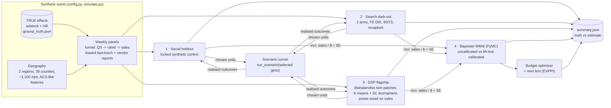

Designs only see pre-launch data; the scenario runner then applies each holdout to exactly the units the code chose,
so the outcome reflects the design. Nothing is hand-picked and nothing is force-passed.

---

## The five modules

### 1 · Social geo holdout - the first, rough-but-correct test

County bundles scored as candidate units, synthetic-control weights **locked** before launch and validated with injected
lifts, closed-form + simulated power, leave-one-donor-out jackknife, readout via week-FE DiD (HC1), ratio DiD and placebo
inference. An 8-week, leaky holdout: the honest output is *directional*, and the readout says so.

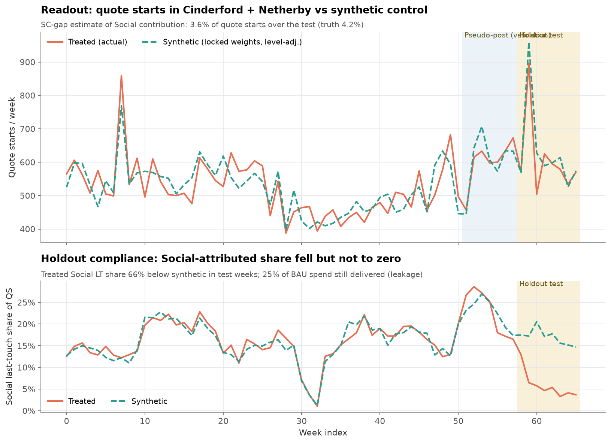
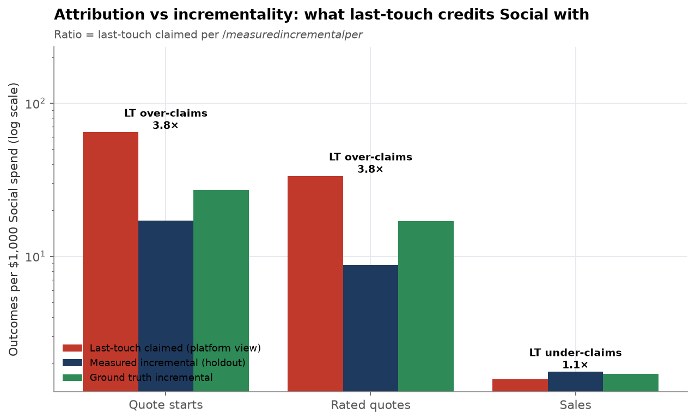

### 2 · Paid Search two-arm dark-out - what is really incremental?

All-search and branded-only arms vs a matched control. Two-way FE DiD with cluster-robust SE, BSTS counterfactual
(significance from the credible interval), injected-lift validation, `TTestIndPower` + simulated power, organic
**recapture** (cannibalisation) and incremental vs last-touch cost per rated quote.

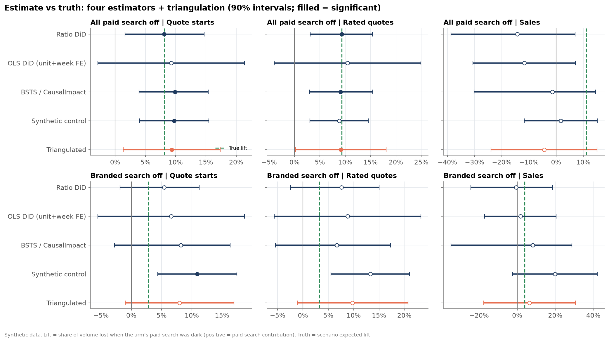
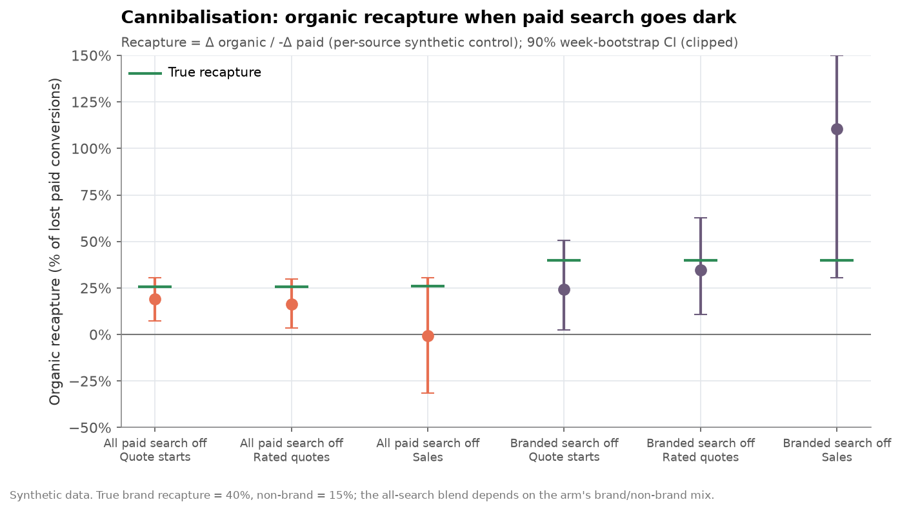

### 3 · Programmatic DSP - the flagship design

Two vendors, two designs. **Vendor A:** 10-mile zip adjacency graph, BFS contiguous patches, haversine spillover buffer,
6-feature Mahalanobis matching with a compactness penalty, strict/relaxed pre-trend gates, SMD balance. **Power drives the
design:** a pre-registered size ladder keeps the smallest strict-gate holdout that detects a 20% *sales* contribution at
80% power. **Vendor B:** vendor-switch structural-break test, geo-weighted K-means, a synthetic-control tournament,
in-space / in-time / random-geography placebos and ridge-augmented SC. Readout triangulates five methods per funnel stage,
and the go/no-go rule hinges on sales: top-funnel lift alone never funds a GO.

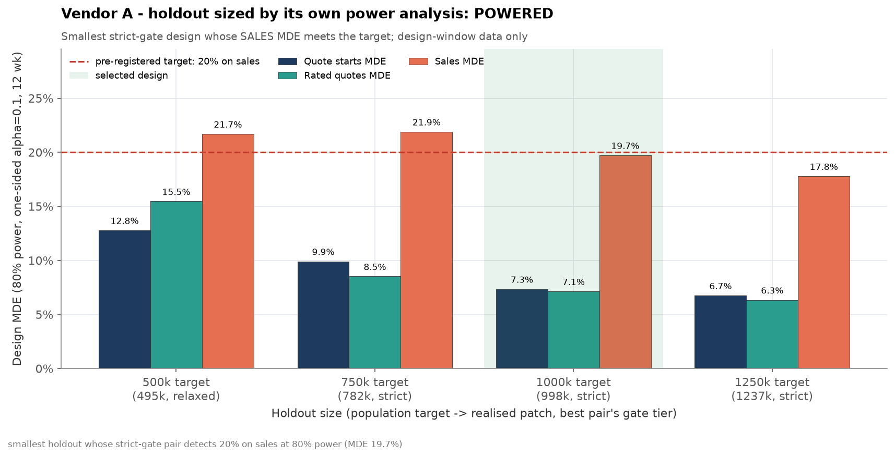
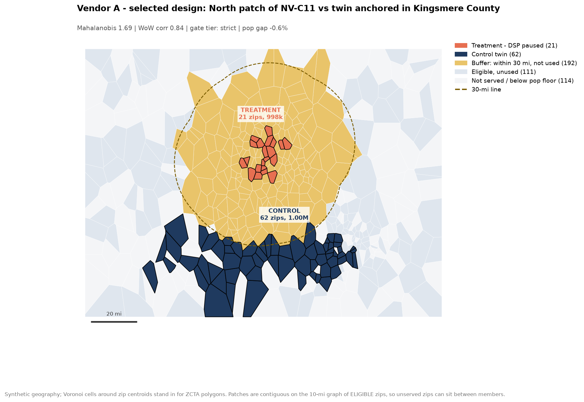
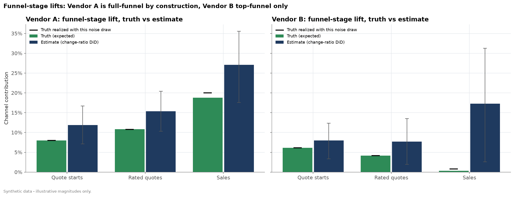

Full method write-up: [`docs/dsp_pipeline.md`](docs/dsp_pipeline.md) · exec readout: [`reports/readouts/dsp.md`](reports/readouts/dsp.md)

### 4 · Experiment-calibrated MMM - closing the gap

Weekly national Bayesian MMM (PyMC: geometric adstock + Hill per channel, trend, seasonality, holidays) fit with and without
one lift-test likelihood term per test arm. Posterior-aware budget optimizer (+-30% per channel, total fixed), response
curves, contribution waterfall, triangulation and an EVPPI-based next-test recommendation.

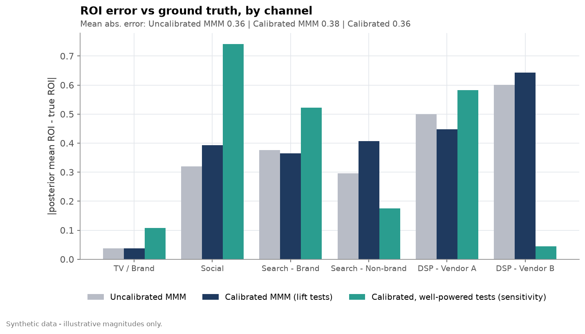
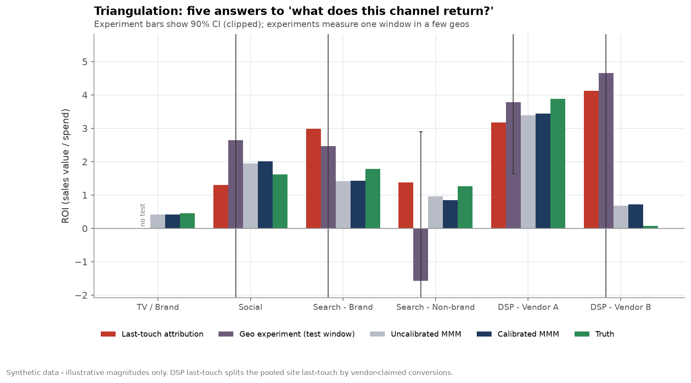
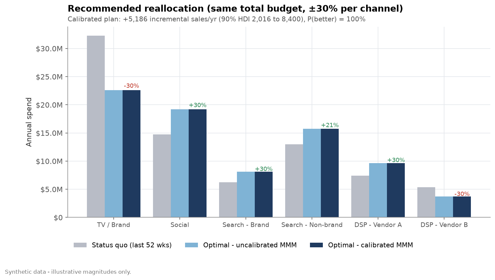

### 5 · Geo-experiment selection - real Census data, end to end

Runs the full lifecycle of picking and sizing a geo experiment on **real geography**: US Census ACS 2018-2022 5-year
demographics (population, income, age, race/ethnicity, education, density) for 39 Massachusetts towns/cities with
population >= 40k, K-means clustered, with a treatment/control pair matched by standardized distance within a cluster.
A closed-form DiD power analysis sizes the test; a **simulated** daily test window (clearly documented, since there is
no real marketing-outcome panel for arbitrary MA towns) injects a known true lift, takes weekly sequential-monitoring
DiD looks, and reads out the final estimate against the known ground truth. Also shipped as a fully self-contained
script (`standalone/geoselect_standalone.py`, no `incrlab` import) so the same pipeline runs standalone on another
project. Census access note: `api.census.gov`'s tabular Data API now requires a registered key for data queries
(302 -> `missing_key.html` without one); both the module and the standalone script instead pull the identical ACS
5-year estimates from the Census Bureau's public, key-free bulk ACS Summary File + Gazetteer distribution.

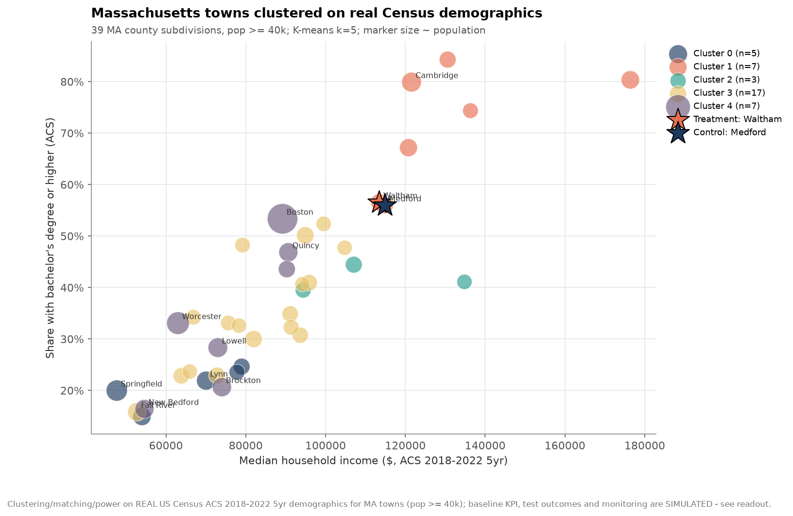
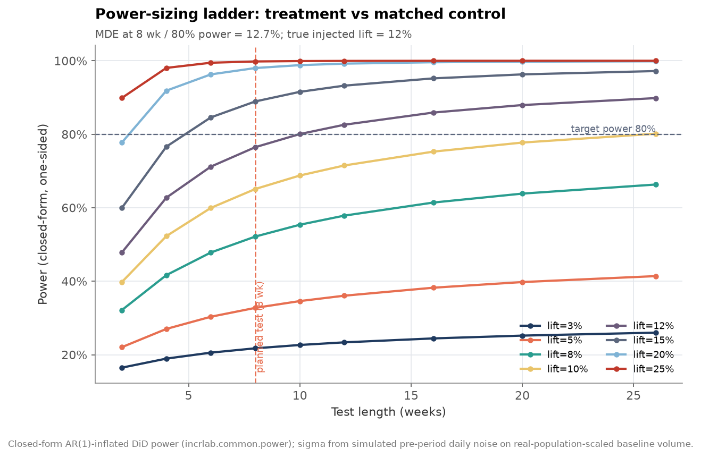
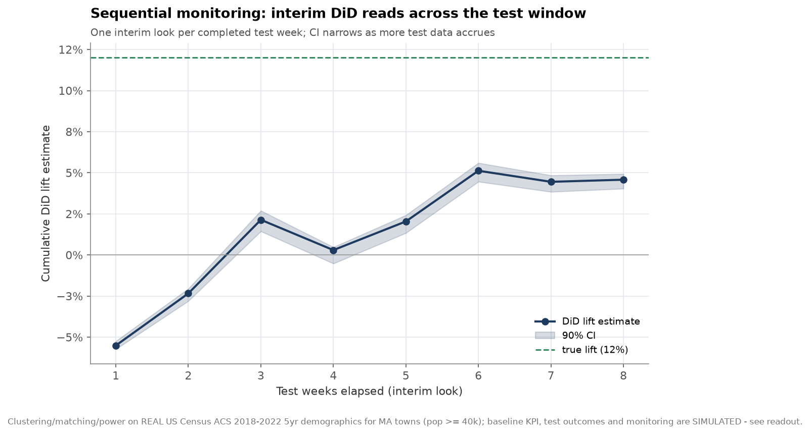

Exec readout: [`reports/readouts/geoselect.md`](reports/readouts/geoselect.md)

---

## The MMM gap (and why calibration did not win here)

Experiments answer *one* question, in *one* window, in a few geos. Budgeting needs a national, always-on,
saturation-aware answer, which is what an MMM gives, but an uncalibrated MMM can only separate channels by how their spend
happened to move. Calibration is the bridge: each test becomes a likelihood term on incremental sales per dollar.

The honest result in this world: with the tests *as actually read out*, calibration does not lower the average ROI error
(see the MMM line above). Four of the five test arms were powered on quote starts, so their **sales** terms are weak
and some point the wrong way; the one test designed for sales (DSP Vendor A) does pull its channel toward the truth. A
sensitivity fit that feeds every test a well-powered, truth-centred readout shows the remaining gap is model-side: a
12-week, geo-local return at test spend only partly identifies a 3-year national ROI. The program's lesson is the
same one the DSP redesign encodes: **power tests on the decision metric, and design them to measure what the MMM
needs.** The budget reallocation is still robust (same direction across all fits) and gains true sales at equal budget.

---

## How to run

```bash
git clone <this repo> && cd incrementality-lab
make venv            # uv venv .venv (Python 3.12) + pip install -r requirements.txt + -e .
make all             # data -> meta -> search -> dsp -> mmm -> summary.json + README numbers -> 5 notebooks
make test            # full test suite;  `make test-small` = CI mode (INCRLAB_SMALL=1)
```

Without uv: `python3.12 -m venv .venv && .venv/bin/pip install -r requirements.txt -e . && make all`.
Single stages: `make dsp`, `python -m incrlab.pipeline dsp mmm`. Runtime on a laptop-class CPU: ~5 min for the pipeline
(MMM sampling dominates), ~10 min more to execute the notebooks. `INCRLAB_SMALL=1` shrinks the geography for CI;
`INCRLAB_EFFECT_MULT=3` scales every true effect for a "clearly significant" demo.

## Repository layout

```
src/incrlab/
  config.py        seeds, TRUE channel effects, test designs (the ground truth lives here)
  geo.py           synthetic geography: counties, zips, adjacency, haversine
  simulate.py      world generator + scenario runner (applies holdouts to selected geos)
  common/          synthetic control, DiD (FE + clustered SE), BSTS, power/MDE, placebo inference, plotting
  meta/ search/ dsp/ mmm/ geoselect/   the five modules (python -m incrlab.<module>)
  pipeline.py      python -m incrlab.pipeline all  -> reports/results/summary.json
notebooks/         00_overview + one executed deep-dive per module
reports/           figures/<module>/*.png, results/*.json, readouts/*.md (exec-style)
docs/              methodology.md, dsp_pipeline.md, API.md
tests/             generator determinism, estimator recovery of injected lifts, design rules, optimizer, README==JSON
legacy/            v1 (single-panel DiD / SC / CUPED / MMM / power demo), kept for history
standalone/        geoselect_standalone.py - self-contained real-Census geo-experiment tool (no incrlab import)
```

## Methods -> skills

| Method | Where | Skill it demonstrates |
|---|---|---|
| Geo experiment design (holdout, two-arm dark-out, contiguous zip patches) | meta, search, dsp | Experiment design under real constraints (leakage, spillover, concurrent tests) |
| Synthetic control with locked weights, AugSynth-style ridge correction | meta, search, dsp | Counterfactual construction without peeking |
| Mahalanobis matching (+ ridge, compactness), geo-weighted K-means | dsp | Market matching at zip granularity |
| Placebo / permutation inference (in-space, in-time, random geographies) | meta, dsp | Small-N inference |
| BSTS / structural time-series counterfactual | search, dsp | CausalImpact-style analysis done right (significance = interval) |
| DiD with unit + week FE and cluster-robust SE; change-ratio DiD with bootstrap | all tests | Panel econometrics |
| Power / MDE (closed form with AR(1), simulation, `TTestIndPower`), power-driven sizing | all tests | Sizing tests on the decision metric |
| Bayesian MMM (adstock + Hill) with lift-test calibration likelihood | mmm | Bridging experiments and always-on budgeting |
| Posterior-aware budget optimization, EVPPI next-test choice | mmm | Turning measurement into money decisions |
| Attribution vs incrementality, vendor-report audits | all | Skepticism toward platform numbers |

## Honest caveats

- **Synthetic.** The simulator's response family matches the MMM's; real programs face misspecification, data
  breaks and organisational constraints not modelled here. Magnitudes are illustrative and depend on the noise draw.
- **Design-dependent.** The DSP test windows were lengthened (6/8 -> 12 weeks) after the module's own pre-period
  power analysis showed the first plan could not resolve sales; true effects were never changed.
- **One draw.** Vendor A's point estimates sit above the truth in this seed; the decision does not depend on the
  overshoot, but a single test is still a single draw.
- **Big holdouts are a business cost.** A sales-grade Vendor A read needs a far larger holdout than the first plan; the sizing table makes
  that trade-off explicit rather than hiding it.

## v1

The original single-panel demo (DiD, synthetic control, CUPED, MMM, power on one injected +12% lift) lives in
[`legacy/`](legacy/) for history.

MIT licensed.
