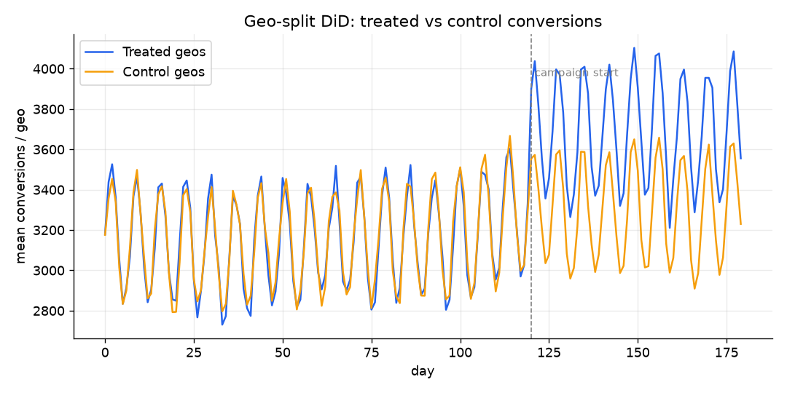
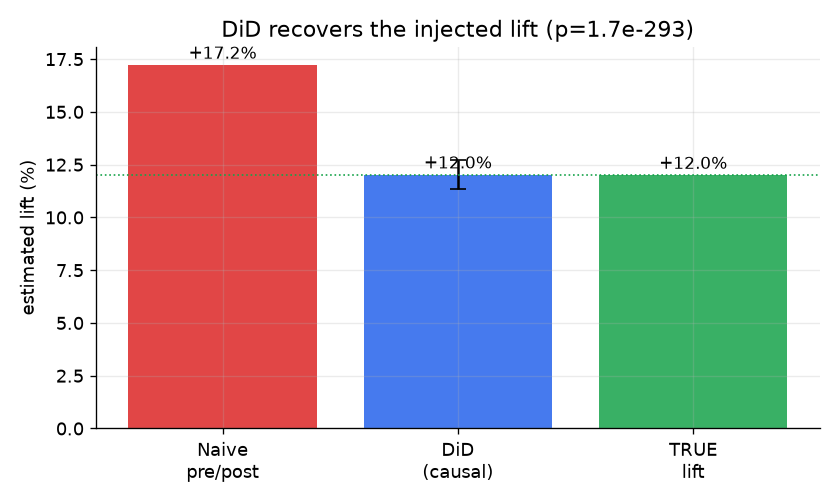
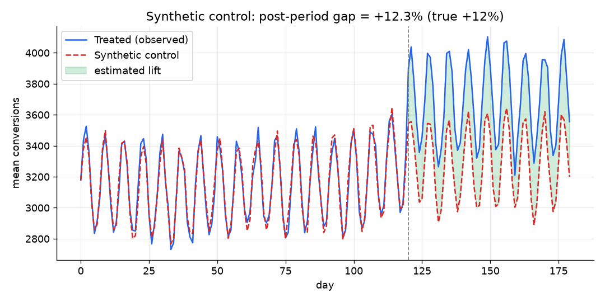
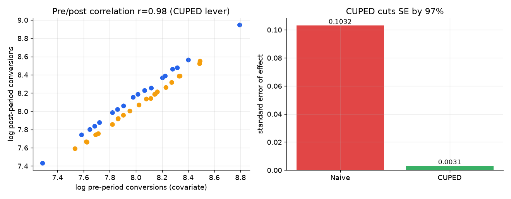
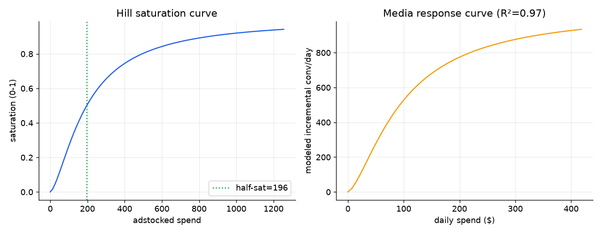
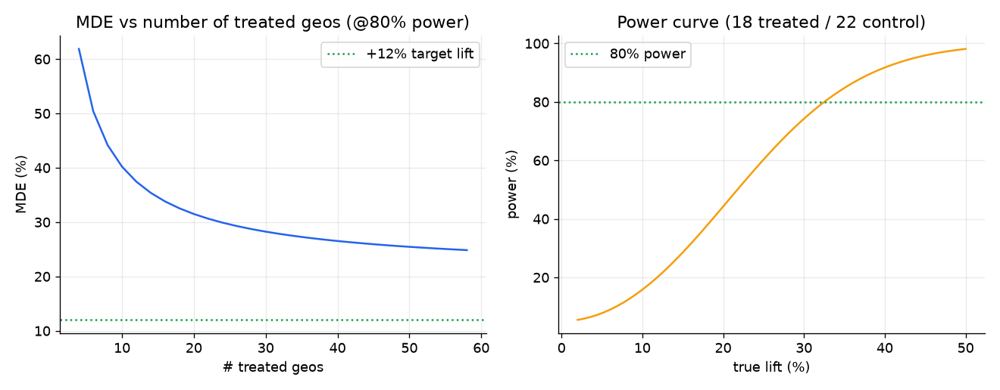

# incrementality-lab

> **v2 in progress (branch `v2`).** The v1 code, notebooks and figures below now live in [`legacy/`](legacy/).
> v2 is an end-to-end measurement program on one synthetic world with known ground truth:
> Social geo holdout -> Paid Search two-arm dark-out -> Programmatic DSP geo tests -> experiment-calibrated MMM.
> Foundation: `src/incrlab/` (`config`, `geo`, `simulate`, `common/`); contract for module builders in [`docs/API.md`](docs/API.md).
> Quick start: `make venv && make data && make test`.

**Runnable proof of marketing-measurement & incrementality methods — on synthetic data with a _known_ ground-truth lift, so you can watch each method recover it.**

This repo generates a realistic multi-geo (DMA-level, daily) marketing panel with a deliberately injected incremental lift of **+12%**, then applies five causal / experimentation techniques and shows that the correct methods recover the true effect while a naive pre/post comparison does not. Everything is reproducible from a fixed seed and runs end-to-end in a clean virtualenv.

> Companion to my portfolio case studies at https://akhilpatil7.github.io/ — that site tells the story; this repo shows the code.

---

## Methods demonstrated

| # | Method | What it answers | Key result (true lift = +12%) |
|---|--------|-----------------|-------------------------------|
| a | **Geo-split Difference-in-Differences** (primary) | Did media cause incremental conversions, net of national trend? | **+12.0%**, 95% CI [+11.3%, +12.7%], p ≈ 1.7e-293 (naive pre/post is biased to +17.2%) |
| b | **Synthetic Control** (validation) | Independent cross-check via a virtual control built from donor geos | **+12.3%** post-period gap; pre-period fit tracks treated closely |
| c | **CUPED** variance reduction | How much smaller can we make the SE / MDE using pre-period data? | SE cut **~97%** (pre/post corr 0.98 in this panel — see note) |
| d | **Marketing Mix Model** (adstock + Hill saturation) | Diminishing returns & response curve for budgeting | R² ≈ 0.97; recovers saturation + carryover shape |
| e | **Power analysis / MDE** | How big a lift is detectable given geos & variance? | MDE @80% power ≈ +33% for this design → motivates more geos / CUPED |

All numbers above are produced by the code in this repo and re-emitted to `reports/results_summary.json` on every run.

---

## Results (figures)

Difference-in-Differences — parallel pre-trends, post-launch divergence:




Synthetic control — virtual control matches pre-period, gap = lift:



CUPED — pre-period covariate slashes the standard error:



MMM — adstock + saturation response curve:



Power / MDE — sizing the experiment:



---

## How to run

```bash
# 1. create a virtualenv (uv or stdlib venv both fine)
python -m venv .venv && source .venv/bin/activate     # or: uv venv .venv
pip install -r requirements.txt

# 2. generate the synthetic panel (writes data/geo_panel.csv + data/ground_truth.json)
python -m src.generate_data

# 3a. reproduce every figure + results_summary.json
python -m src.make_figures

# 3b. or run any single analysis from the CLI
python -m src.did
python -m src.synthetic_control
python -m src.cuped
python -m src.mmm
python -m src.power

# 4. open the notebooks for the narrated walk-throughs
jupyter lab notebooks/
```

Both notebooks are committed **already executed** so reviewers can read them on GitHub without running anything:
- `notebooks/01_did_synthetic_control.ipynb`
- `notebooks/02_cuped_mmm_power.ipynb`

---

## Repo structure

```
incrementality-lab/
├── src/
│   ├── generate_data.py       # synthetic multi-geo panel w/ injected TRUE_LIFT
│   ├── did.py                 # geo-split difference-in-differences (clustered SE)
│   ├── synthetic_control.py   # donor-weighted virtual control (SLSQP)
│   ├── cuped.py               # CUPED variance reduction
│   ├── mmm.py                 # adstock + Hill saturation MMM
│   ├── power.py               # MDE / power calculator
│   └── make_figures.py        # runs all analyses, writes reports/figures/*
├── notebooks/                 # executed narrative notebooks
├── reports/
│   ├── figures/               # generated PNGs
│   └── results_summary.json   # machine-readable key results
├── data/                      # generated CSV (gitignored) + ground_truth.json
├── requirements.txt
├── LICENSE                    # MIT
└── README.md
```

---

## What this demonstrates (mapping to the skillset)

- **Causal inference for marketing:** difference-in-differences and synthetic control as complementary quasi-experimental designs, with fixed effects and geo-clustered inference.
- **Experiment design & craft:** CUPED variance reduction and power/MDE sizing — the difference between an underpowered geo test and a decisive one.
- **Media modeling:** adstock (carryover) + Hill saturation, the standard MMM building blocks, with response curves for budget decisions.
- **Reproducibility & validation:** because the ground-truth lift is injected, every estimate is checkable — the code is honest about when a method is biased (naive pre/post) vs. unbiased (DiD, synthetic control).

## Notes & honest caveats

- **Data is 100% synthetic** and generated by `src/generate_data.py` with a fixed seed. The point is validation-by-construction: you can see the methods recover a lift you already know.
- **The CUPED result is unusually strong** (~97% SE reduction) because in this synthetic panel a geo's pre-period volume is a near-perfect predictor of its post-period volume (corr ≈ 0.98). On real data the covariate correlation is lower, so expect a more modest — but still meaningful — reduction. The *mechanism* shown is correct; the magnitude is design-dependent.
- The MMM uses fixed adstock decay / saturation shape for clarity; a production version would grid-search or Bayesian-fit those hyperparameters.

## License

MIT — see [LICENSE](LICENSE).
