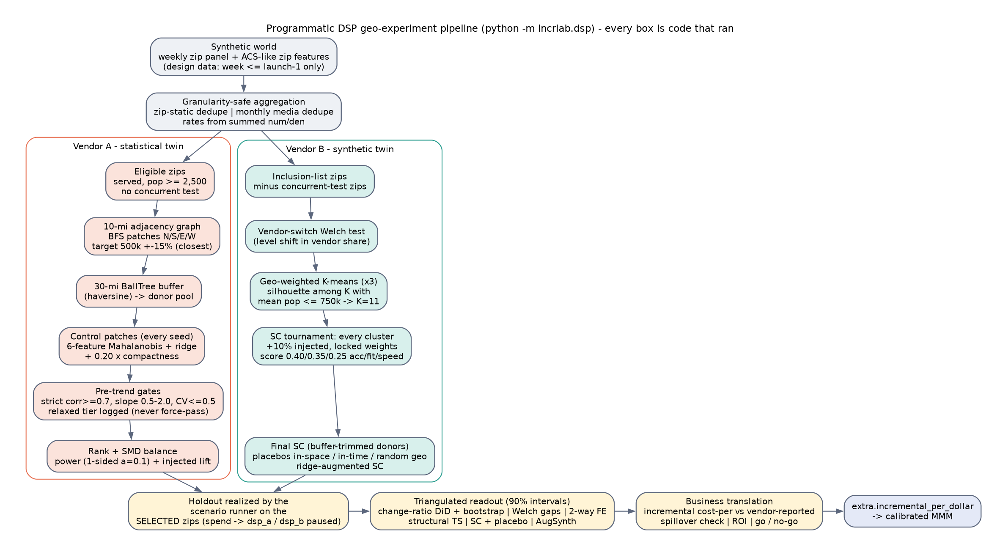

# Programmatic DSP geo-experiment program - methodology

`python -m incrlab.dsp` (or `make dsp`) runs everything below end to end in about 40 s (full geography):
two pre-launch designs, the holdouts realized on the zips the designs chose, a triangulated readout,
29 figures (`reports/figures/dsp/`), `reports/results/dsp.json` and the executive readout
`reports/readouts/dsp.md`. The narrated walk-through is `notebooks/03_dsp.ipynb`.

## Code map

| File | Role |
|---|---|
| `dsp/params.py` | Every design/readout parameter (`VendorAParams`, `VendorBParams`, `ReadoutParams`). Chart labels are generated from these values. Small/CI mode scales population targets. |
| `dsp/features.py` | Granularity-safe aggregation, SMD balance table, `ZipCube` (dense zip x week arrays for fast subset sums). |
| `dsp/design_a.py` | Vendor A: BallTree adjacency graph, BFS patches, haversine buffer, Mahalanobis scoring, pre-trend gates, ranking, power, injected-lift check. |
| `dsp/design_b.py` | Vendor B: vendor-switch structural-break test, geo-weighted K-means, synthetic-control tournament, final SC, placebos, ridge-augmented SC. |
| `dsp/readout.py` | Runs `simulate.run_scenario` on the selected zips; change-ratio DiD, Welch, FE regression, structural time series, SC + placebos, AugSynth; business translation, spillover check, go/no-go. |
| `dsp/figures.py` | All figures (shared theme from `incrlab.common.plotting`). |
| `dsp/pipeline.py`, `dsp/__main__.py` | Orchestration, results JSON, markdown readout. |

## Data rules ("never average averages")

1. Zip-static features (ACS-like census fields, lat/lon, pop) are de-duplicated per zip and aggregated with
   population weights.
2. Monthly media columns (`*_month`) repeat on every weekly row, so they are de-duplicated on
   `(month_start, zip)` before summing (`features.monthly_media`).
3. Weekly outcomes are summed directly, and every rate (rated rate, close rate, QS per capita, vendor
   share) is recomputed from summed numerators and denominators at the target grain.

Designs only see `week_idx <= design_end` of their test. Vendor-reported series are passed through
`simulate.apply_report_lag` so they show the attribution lag the analyst would have seen on the design date.
`tests/test_dsp.py::test_design_never_sees_post_launch_data` zeroes every post-design week and checks
that the selected units do not change.

## Vendor A - contiguous patch vs a Mahalanobis-matched twin

1. **Universe.** Vendor-served zips in the region with population >= `min_zip_pop`. Zips flagged in a
   concurrent test are excluded.
2. **Treatment patches.** The `n_treatment_counties` most populous eligible counties are used. Each one
   gets a 10-mi adjacency graph (BallTree `query_radius` with haversine, networkx graph). Each patch is
   grown by FIFO BFS from the county's extreme N/S/E/W zip. Growth keeps going inside the
   +-`pop_tolerance` window and returns the prefix **closest to the target**. The original rule stopped at
   the lower bound; the figure prints what that rule would have given.
3. **Spillover buffer.** A haversine BallTree is built on the treatment centroids. A donor zip is valid
   only if `count_only` within `buffer_miles` is 0. The same parameter draws the dashed iso-distance line
   on every map and fills every legend label.
4. **Control patches.** BFS runs from *every* valid donor zip over the donor-only adjacency graph, and
   duplicate patches are dropped with `frozenset`. Every unique in-window patch is scored, and the top
   `top_per_county` per (treatment patch, control anchor county) are kept. The original logged a
   candidate only when the per-county best improved, so its candidate list depended on seed order.
5. **Score.** Mahalanobis distance is computed on 6 population-weighted features (per-capita income,
   bachelor's share, LFPR, QS per capita, rated rate, close rate). Features are standardised and
   `VI = inv(corr + ridge I)`. That is the raw-scale metric with a scale-aware ridge: a 1e-6 ridge on raw
   covariance would only regularise the share dimensions. To this is added
   `w_compact x min(c_spread/t_spread, 3)/3`, where spread = mean distance to the k=5 nearest patch
   neighbours. The covariance is zip-level by design. A patch-level covariance (bootstrapped random BFS
   patches) is reported as a sensitivity column (`maha_patch_cov`).
6. **Pre-trend gates** run on weekly rated quotes for the top `top_n_validate` candidates: WoW %-change
   correlation, slope ratio of mean-normalised levels, and CV of each side. A **strict** tier and a
   **relaxed** tier are both evaluated and logged with fail reasons. The winner comes from the best
   available tier, and if no candidate passes even the relaxed tier the design is flagged NOT VALIDATED.
   Nothing is ever force-passed.
7. **Ranking.** Candidates are sorted by tier first, then by `rank(composite) + rank(-WoW corr) +
   rank(weeks to detect 15%) + rank(|in-time placebo drift|)`. The drift term is the change-ratio "effect"
   over the last design weeks with no intervention.
8. **Balance.** Population-weighted SMD table with |SMD| < 0.10 / < 0.25 flags. This is an enhancement;
   the original showed only %-gap bars.
9. **Power.** One-sided alpha = 0.10, 80% power. Sigma = sd of the weekly relative treatment-control gap
   over the design window, the SE is AR(1)-inflated, and n_pre = the readout pre-period length. The
   original's level-difference formula is kept in `dsp.json` for comparison only.
10. **Power-driven sizing (pre-registered).** Steps 2-9 run once per rung of `size_ladder`
    (0.5M, 0.75M, 1.0M, 1.25M population; capped at `max_holdout_share` of the served population). The
    design keeps the **smallest holdout whose best strict-gate pair has a SALES MDE <= `target_mde` (20%)**
    at 80% power over the configured test window. If no rung qualifies, the strict design with the lowest
    sales MDE is used and flagged UNDER-POWERED; a relaxed pair is used only if no rung has a strict pair
    (flagged NOT VALIDATED). Design-window data only; ground truth is never consulted. The ladder is in
    `dsp.json -> design.dsp_a.sizing_ladder` and figure `08b_a_power_sizing_ladder.png`.
11. **Injected-lift check.** The last 6 design weeks act as a fake holdout. 5/10/15/20% is removed from the
    treatment only, and the change-ratio DiD recovers it after subtracting the natural drift.

## Vendor B - geo-weighted cluster vs a synthetic twin

1. **Universe.** Zips on the vendor inclusion list, minus the concurrent-test zips (shown dark grey on the
   map; they take precedence over cluster colour).
2. **Vendor-switch structural break.** Welch t-test on the weekly vendor-attributed QS share before vs
   after the switch, with reporting-dip weeks excluded. The test returns a "cannot test" decision when
   one side has fewer than 2 weeks (the original returned NaN silently). When the shift is significant,
   vendor-share predictors use post-switch, non-dip, non-lagged weeks only. The SC dependent is QS per
   capita, the business KPI, which vendor reporting cannot move. `share_compare` records the vendor-share
   SC fit for reference.
3. **Geo-weighted K-means.** StandardScaler on 9 features, with lat/lon multiplied by `geo_weight`. A
   silhouette search runs over the K range. K is a **documented business rule**: the best silhouette among
   K whose mean cluster population is <= `cluster_pop_target`. Both K values are recorded and plotted.
4. **Tournament.** Every cluster takes a turn as pseudo-treatment. SC weights are fit on the fit window
   and locked. +10% is injected into the pseudo-post weeks (donors untouched), and the natural pseudo-post
   gap is subtracted. Accuracy = |detected - 10%|, fit = relative RMSE, and speed = weeks to 80% power at
   10%. Score = 0.40 / 0.35 / 0.25 on percentile ranks. Feasibility rules are explicit: population bounds,
   not the largest-volume cluster, and weeks-to-power <= 20. `analyst_override` raises if it has no
   `analyst_rationale`. Errors are logged as rows, never dropped.
5. **Final SC.** Donor clusters are rebuilt without zips inside the buffer. The SC is cluster-level QS per
   1k population (ratio of sums), with a V-table (equal V), an injected-lift check, in-space placebos (K-1
   clusters; min p = 1/K), in-time placebos, ~100 random contiguous-geography placebos (many more
   permutations), and a ridge-augmented SC whose lambda is chosen on held-out late-pre weeks.

## Readout (both vendors)

The holdouts are realized by `simulate.run_scenario({"dsp_a": {"holdout": A.treated}, "dsp_b": {"holdout": B.treated}})`.
Spend is set to `leakage` x BAU in the selected zips, and the effect follows from the true adstock + Hill
response. An assertion checks that the scenario's arm labels match the selected zips exactly. Every
estimate is a channel **contribution** (`sign=-1`: positive = volume lost when paused). Every interval is
90%, and **significance means only that the interval excludes 0**.

| Method | Detail |
|---|---|
| Change-ratio DiD (headline) | cf = T_pre x C_post/C_pre on weekly means; week bootstrap gives the CI and the SE of incremental volume |
| Welch t on weekly gaps | Gaps of pre-mean-normalised series; Welch-Satterthwaite CI |
| Two-way FE regression | Zip + week FE, population WLS (Vendor B donors carry their locked SC weights), cluster-robust SE by zip |
| Structural time series | statsmodels UnobservedComponents (local level + control regressor) on a long pre-period; CI from simulated cumulative counterfactuals |
| Synthetic control + placebos | Vendor A: SC on county donor groups outside the buffer. Vendor B: the locked design weights. Late-pre bias removed; p and interval from in-space + random-geography placebo nulls |
| Ridge-augmented SC (Vendor B) | AugSynth-style correction of residual pre-period imbalance |

Business translation:
- Incremental cost per QS / rated / sale = estimated spend removed / incremental volume, compared with
  vendor-reported and site last-touch cost-pers.
- Window ROI with bootstrap P(ROI > 1).
- Spend-compliance chart.
- Spillover check: served buffer zips vs the control, and the lift an adjacent control would have produced.
- `extra.incremental_per_dollar` (sales, qs and rated per $, with SE) for the calibrated MMM.

**Go / no-go (pre-registered, hinges on sales).** GO needs a significant sales-stage DiD from a design
powered for sales (design sales MDE <= 20%) *and* P(ROI > 1) >= 0.80. NO-GO is P(ROI > 1) <= 0.20, or a
sales-powered design whose 90% interval rules out the break-even lift. A design not powered for sales
returns at most HOLD - RE-TEST POWERED ON SALES: top-funnel lift alone, or a "significant" sales read from an
under-powered design (exaggerated by construction), never funds a GO. Otherwise LEAN GO - CONFIRM /
INCONCLUSIVE - EXTEND.

**MMM hand-off.** `extra.incremental_per_dollar[*].se = max(bootstrap SE, design SE)`, where the design SE is
the pre-period sales MDE / (z_alpha + z_power) in sales-per-$ units, so a lucky narrow interval from an
under-powered test cannot dominate the calibration likelihood.

## Design change log (v2)

The first version of the Vendor A plan (0.5M pop, 6 test weeks, 10 readout-pre weeks) had a QS MDE of 17%,
a sales MDE near 30%, and its best pair passed only the relaxed gates. It read a +15% true sales contribution
as -2% and returned the wrong decision. The fix is a design decision driven by the module's own pre-period
power analysis, not by the truth: the test window was lengthened to 12 weeks (both vendors) with a 16-week
readout pre-period for Vendor A, and the holdout is sized by the ladder above. True effects were not changed.

## Fixes to the 17 issues in the original notebooks

| # | Original issue | Fix here |
|---|---|---|
| 1 | Buffer was 30 mi in code, "100 mi" in charts | One `buffer_miles` parameter drives the BallTree, the dashed map line and every label |
| 2 | Failed pair force-passed (`pass=True`) | Explicit strict / relaxed tiers, logged with reasons; NOT VALIDATED flag; tested |
| 3 | Relaxed fallback never ran | Both tiers are always evaluated and reported |
| 4 | BFS stopped at the lower population bound | Stops closest to target (old value shown in the patch figure; unit-tested) |
| 5 | Candidates logged only when the county best improved | Every unique patch scored; top N per county kept |
| 6 | Zip-level covariance applied to patch means | Documented; patch-level bootstrap covariance reported as a sensitivity |
| 7 | Silhouette chose K=3, then K=10 hard-coded | K from a documented population rule; silhouette curve plotted with both K |
| 8 | Treatment cluster hard-coded | Chosen by score + feasibility; override requires a rationale string |
| 9 | Notebook-state bugs (undefined names, mismatched RMSE) | Package code, one source of every number, notebook executed top to bottom in CI |
| 10 | Placebo compared sums of shares with mean shares | One unit everywhere: cluster QS per capita = ratio of sums |
| 11 | Structural-break test returned NaN | Guarded empty-group branch with an explicit decision (tested) |
| 12 | Three power conventions | One convention (one-sided 0.10, relative-gap sigma, AR(1) inflation) labelled on every chart |
| 13 | CausalImpact p-value contradicted its CI | Own structural TS; significance = CI excludes 0 only |
| 14 | 9-donor permutation floor (p >= 0.11) | ~100 random-geography placebos added; the floor is shown on the chart |
| 15 | Sign convention differed between notebook and PDF | `ReadoutParams.sign`; every axis says "contribution (positive = lost when paused)" |
| 16 | Monthly media repeated weekly | De-duplication helper + unit test |
| 17 | Leakage hygiene | Kept: weights fit on pre data and locked; injection on treatment only; natural bias subtracted |

## Honest limitations

- The Vendor A twin is imbalanced on some demographics (see the SMD table); change-ratio DiD removes
  level gaps, and the strict pre-trend gates support (but cannot prove) parallel relative trends.
- A 1M-pop holdout is a large business ask (~17% of the served population of the region); that is the
  price of a sales-grade read in this world, and the sizing table makes the trade-off explicit.
- Vendor B's sales MDE stays well above 20% at 12 weeks, so its sales read is not decision-grade by rule.
- Placebo-based SC intervals assume the placebo geographies are exchangeable with the treated one.
- Synthetic world: magnitudes are illustrative, and conclusions depend on the design and the noise draw.
  Set `INCRLAB_EFFECT_MULT=3` to see a clearly significant case.
