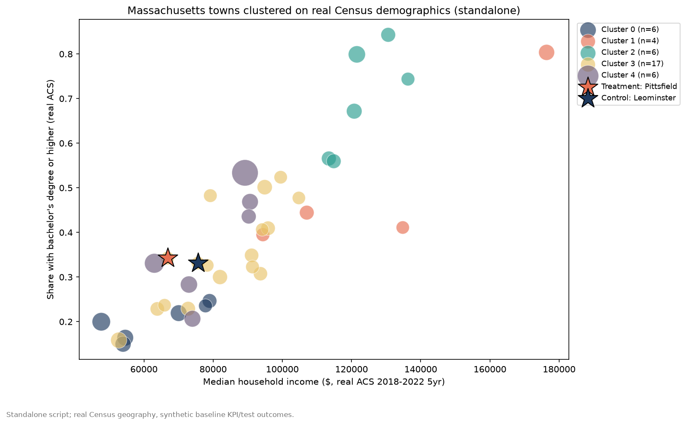
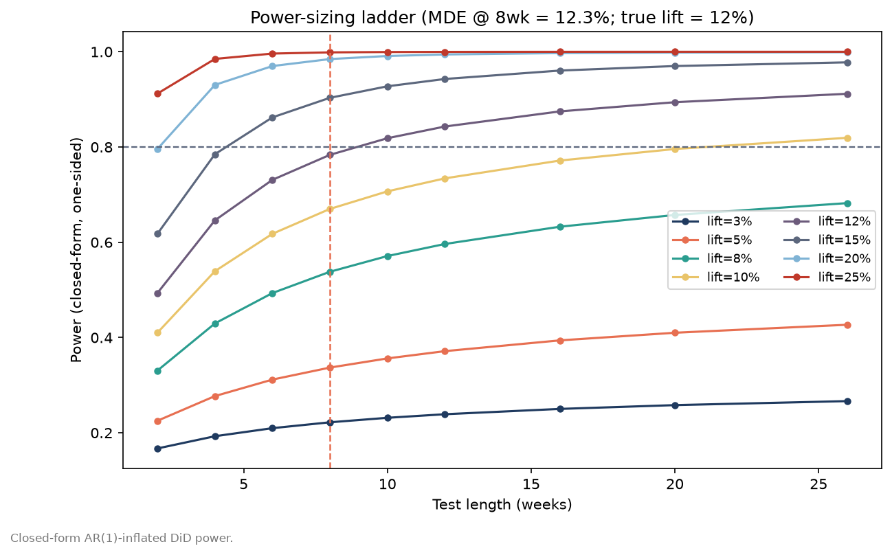
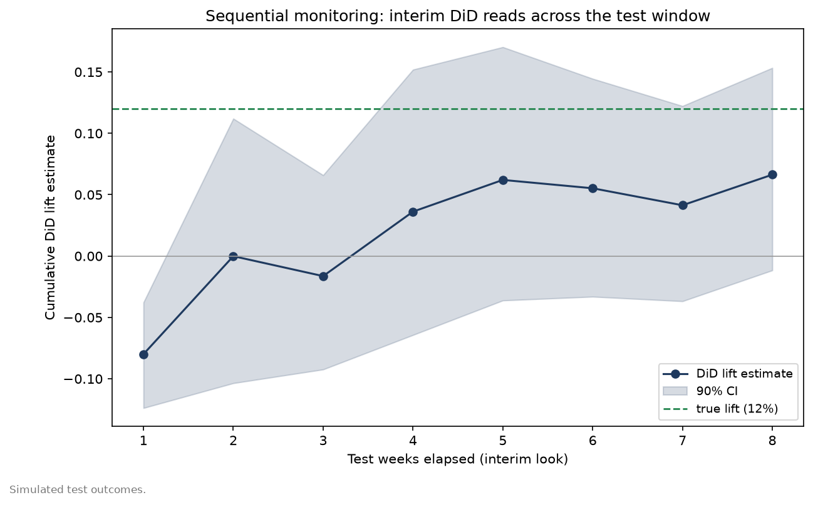
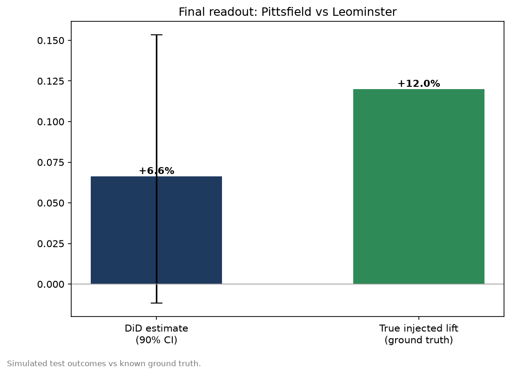

# Standalone geo-experiment readout (Massachusetts, real Census demographics)

*Geography/demographics real (US Census ACS 2018-2022 5yr); baseline KPI, test outcomes and
monitoring are SIMULATED (true lift known by construction). Generated by
`geoselect_standalone.py`; full numbers in `results.json`.*

**Treatment:** Pittsfield (pop 43,730) vs
**control:** Leominster (pop 43,620), cluster
3 (size 17, standardized distance 0.735).

- Design MDE @ 8wk / 80% power: **12.3%**
- Weeks to 80% power at the true 12% lift: **9**
- Final DiD lift: **+6.6%** [90% CI -1.2%, +15.3%] vs
  true **+12.0%** — interval **covers** the truth.

## Census data source note
api.census.gov's tabular Data API now requires a registered key for every data query (we don't
have one); this script instead pulls the same ACS 2018-2022 5-year estimates from the public,
key-free bulk ACS Summary File + Gazetteer distribution on www2.census.gov. Real MA geography,
no rate-limit issue encountered.

## Figures

